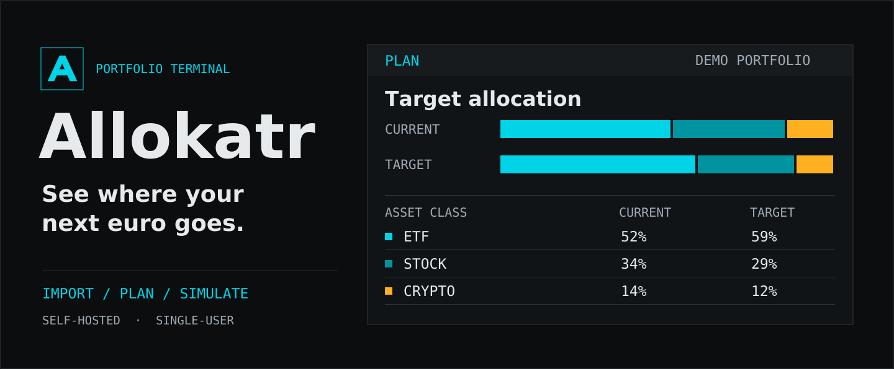

<div align="center">


# Allokatr

**See where your next euro goes.**

A self-hosted portfolio planner for [Parqet](https://parqet.com) and [Interactive Brokers](https://www.interactivebrokers.com/) holdings. Set allocation targets and test changes before you trade.

[Explore the planner](#what-you-can-do) · [Quick start](#quick-start) · [Under the hood](#under-the-hood)



<sub>Illustrated preview with demo data, not an app screenshot.</sub>

</div>

## What you can do

| Question | Where Allokatr helps |
| :--- | :--- |
| Where should my next €1,000 go? | **Plan:** Set targets, track your budget, and see potential buys or sells under stock, ETF, and crypto constraints. |
| Am I too concentrated? | **Concentrations:** Check the allocation heatmap across portfolios. |
| What if I shift 5% into crypto? | **Simulator:** Compare changes against your portfolio in Overlay or use a standalone Sandbox. Neither changes your actual holdings. |
| How is this position doing, and why did I buy it? | **Performance and thesis notes:** Track portfolio metrics, per-position P&L and the rationale for each holding. |

Import Parqet CSVs or IBKR Flex exports. Add unlisted holdings or off-exchange crypto manually, set custom values, or look up listed holdings via yfinance. Track uninvested cash separately or include it in allocation calculations.

## Quick start

Requires Python 3.11+ and Node.js 22.

```bash
git clone https://github.com/icon3333/Allokatr.git
cd Allokatr
./dev.sh
```

Open `http://localhost:3000`. The Flask API runs on port `8065`. The app creates `.env` and the SQLite database on first run.

## Under the hood

Flask JSON API (Python) + Next.js 16 frontend (React 19, Tailwind, shadcn/ui). SQLite database. Prices via yfinance, cached 15 min. FX rates cached 1 hour. Auto-backup every 6 hours.

### Architecture

| Layer | Where |
|-------|-------|
| Routes (HTTP + auth) | `app/routes/` |
| Services (business logic) | `app/services/` |
| Repositories (data access) | `app/repositories/` |
| Database | `instance/portfolio.db` |
| Frontend | `frontend/` (Next.js) |

Deeper notes in [`CLAUDE.md`](CLAUDE.md).

### Configuration

Everything has sensible defaults — just run `python3 run.py` and it generates `.env` for you. Override via env vars:

| Variable | Default | Purpose |
|----------|---------|---------|
| `SECRET_KEY` | auto-generated | Session encryption |
| `FLASK_ENV` | `development` | `development` / `production` |
| `APP_DATA_DIR` | `instance` | DB + backup location |
| `PRICE_UPDATE_INTERVAL_HOURS` | `24` | Price refresh cadence |
| `BACKUP_INTERVAL_HOURS` | `6` | Auto-backup cadence |
| `MAX_BACKUP_FILES` | `10` | Backup retention |

### Data & access

Allokatr is designed for one user on a homeserver. Data persists in `./instance`. Authentication uses sessions without passwords; keep it off the public internet unless you’ve reviewed access controls.

### Security

- Parameterized SQL everywhere
- Session cookies are HttpOnly + SameSite
- Inputs validated, structured exceptions throughout
- `.env` gitignored, secrets auto-generated

## Feedback

If an import misreads your holdings or a rebalance looks wrong, [open an issue](https://github.com/icon3333/Allokatr/issues) or send a PR.

## License

[MIT](LICENSE).
